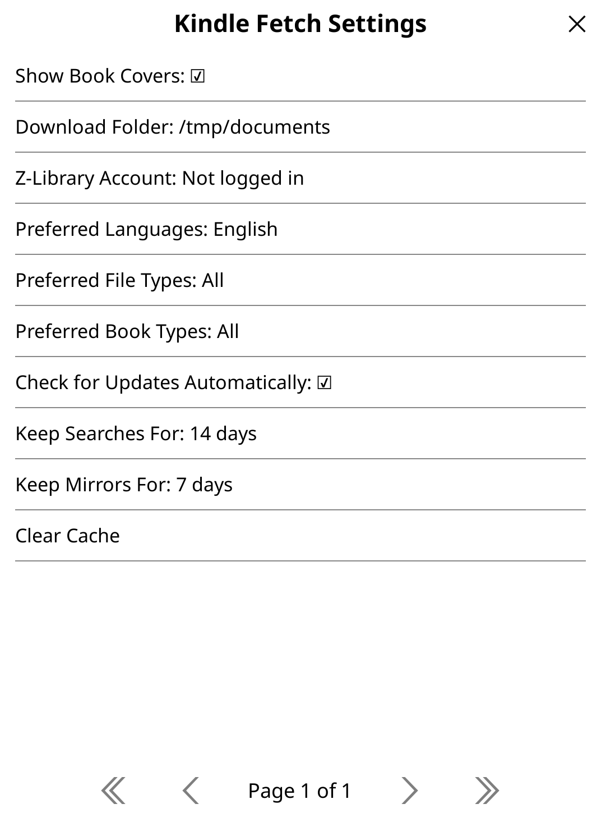
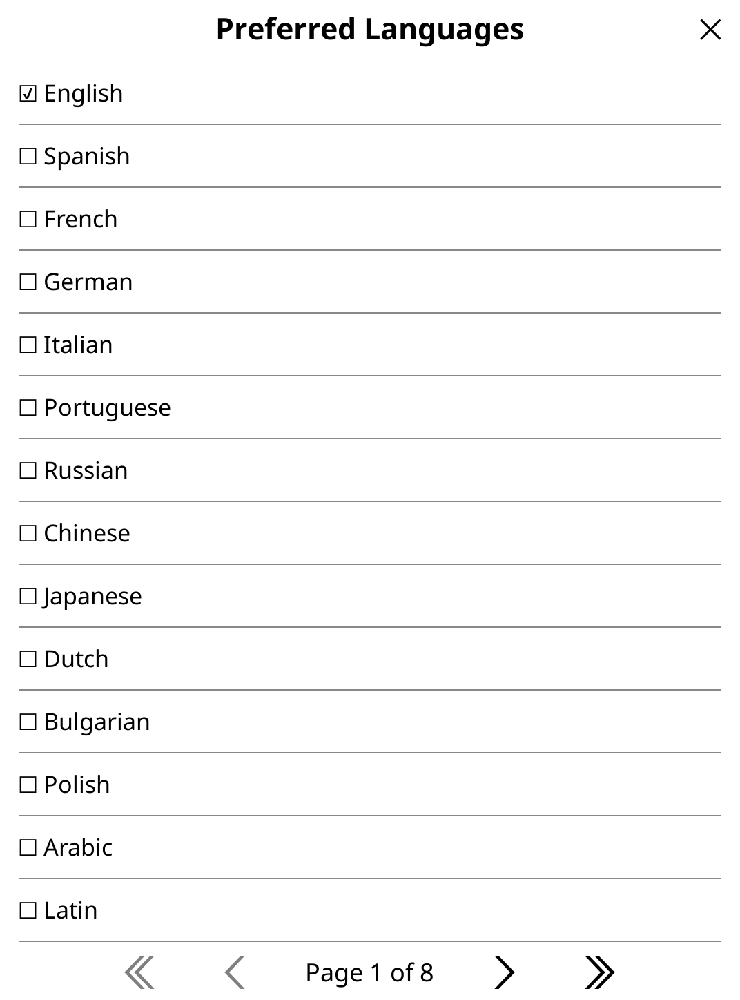
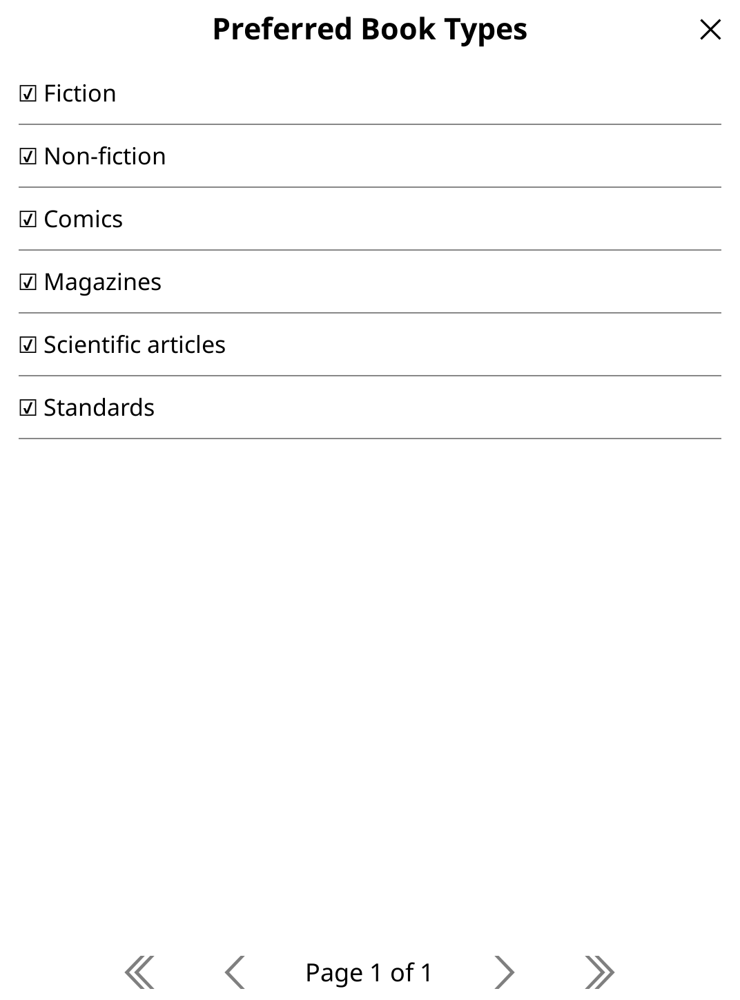
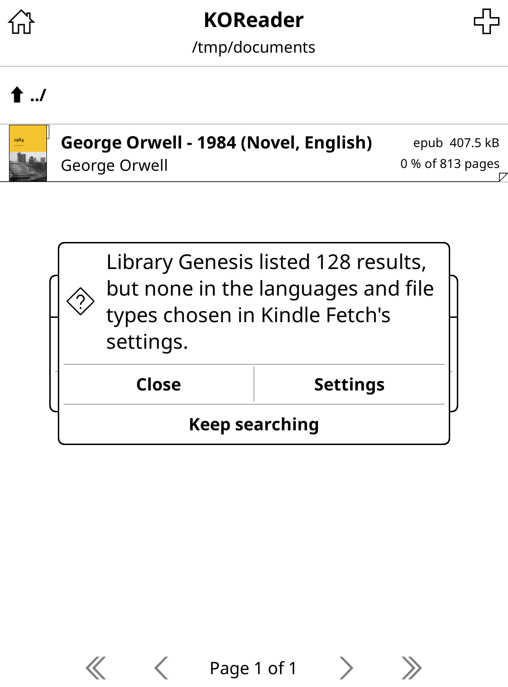
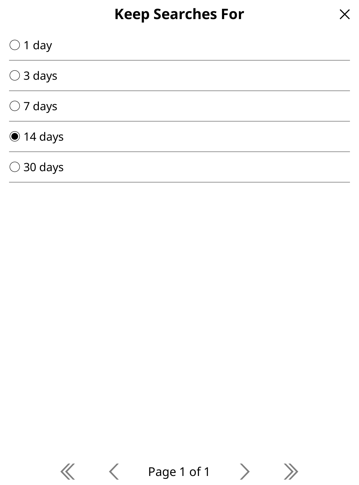

# KindleFetch

<a href="https://github.com/william-spongberg/KindleFetch.koplugin"></a> <a href="https://github.com/william-spongberg/KindleFetch.koplugin"></a> <a href="https://github.com/william-spongberg/KindleFetch.koplugin"></a>

Download books from Library Genesis, Internet Archive and Z-Library directly to your Kindle (or any e-reader running KOReader), entirely within the KOReader app.

## Overview

KindleFetch integrates Library Genesis, Internet Archive and Z-Library into KOReader, allowing you to search for and download books without leaving your e-reader. The plugin handles the entire workflow - from search queries to file downloads - with an intuitive interface and robust error handling.

## Features

- **Book Search + Downloads**: Search Library Genesis, Internet Archive or Z-Library (once logged in to your account) from your device with simple text input and download with a tap; searches run in the background and can be cancelled, and books you have already downloaded are marked in the results
- **Caching**: Minimise network requests and improve performance
  - Search results (2 week expiry by default, 100 entries max)
  - Library Genesis' mirrors and Z-Library's addresses (1 week expiry by default)
  - Book covers (500 entries max, the oldest removed to make room)
- **Preferences**: Filter results by preferred languages, file types, and book types (on Library Genesis)
- **Looking Through Results**: Show only the books found with some text in their title, authors or file type, without searching again, or change the languages, file types and book types they can be in from the menu at the top of the results, searching again with them
- **Other Sites**: When a search finds nothing, or fails, offers to search the other sites for the same thing (Z-Library once logged in)
- **Book Cover Previews**: Display cover images in search results and the download prompt, with placeholders until each one arrives; tap a cover in the download prompt to see it full size
- **Download Progress**: Visual download progress bar with real-time file size information, saying what it's waiting for until the book starts to arrive, and when the download has stalled
- **Background Downloads**: Downloads run in the background using curl, or where there's no curl that can (such as on a Kobo, which may have none at all), KOReader's own HTTP in a process of its own, with non-blocking UI updates; hide a download, and see its progress again from Kindle Fetch's Downloads entry or by choosing its book again; downloads are cancelled when KOReader closes, including when the device is powered off or restarted, or its storage is shared over USB
- **Staying Awake**: Keeps the device from going to sleep while books download, as that turns Wi-Fi off: no standby between taps, and no suspending while it isn't used (by KOReader's AutoSuspend, or a Kindle's own screensaver), each put back as it was once the last download is over
- **Checked Downloads**: Checks each book that downloads is the book, rather than a web page a site sent in its place (e.g. to say it's busy), that it's in its file type, that all of it arrived, and, where the site lists its MD5 (Library Genesis and Internet Archive), that it's the very file listed, checking a large one a piece at a time so KOReader carries on meanwhile; one that isn't is tried again from the beginning, through the proxy or with another link where there is one, otherwise the download fails saying why. Covers that aren't images are left out, rather than kept for good
- **Read Now**: Offers to open a book as soon as it has downloaded, or to show its folder, add it to a collection or see its information as KOReader's file browser does, which lists it straight away
- **Wi-Fi and Gestures**: Turns on Wi-Fi to search if it's off, and search can be opened from a gesture (Kindle Fetch for Library Genesis, or Kindle Fetch: search Internet Archive or Z-Library, in KOReader's gesture manager)
- **Automatic Curl Updates**: Offers to install curl 8.21.0, the latest static build, on Kindles with an older one (downloading it with KOReader's own HTTP, as a Kindle's own curl can be too old to connect to GitHub, and only installing the build that was released, keeping the old curl until the new one has been copied over in full and runs, so there's always a curl that does), and says how to update it when a download fails because a Kindle's own curl is too old to connect to Library Genesis
- **Automatic Plugin Updates**: Checks for new plugin releases in the background, at most once a day, and prompts to update with release notes, then offers to restart KOReader to use the new version (can be turned off in settings, or checked for manually from the menu); an update you turn down isn't offered again until you check manually. The version installed before an update is kept, to go back to from Kindle Fetch's menu (Go back to v…) if the new one doesn't work on your device, and if it can't even start, Kindle Fetch's menu says so and offers to go back, rather than disappearing from KOReader's menu. Where curl can't look them up (on a Kindle until it has been updated, or a device without curl), updates are only checked for manually, with KOReader's own HTTP, which holds KOReader up until GitHub answers
- **Automatic Retry Logic**: Fallback to other available urls if connection fails
- **Safe File Handling**: Automatic filename sanitisation and directory management, asking before downloading over a book that's already there; before a book's link is looked up, it checks the folder can be found and written to (downloading to the default folder for now when the one chosen in the settings is missing, as on an SD card that has been taken out), and that no other book is downloading to the same name

## Installation

1. Ensure you have the latest stable release of KOReader installed (the nightly release has been known to cause issues with this plugin)

2. Download the latest release from the [Releases](https://github.com/william-spongberg/KindleFetch.koplugin/releases) tab

3. Unzip and move its contents into the `plugins` folder of KOReader

## Usage

### Downloading books

#### Search → Kindle Fetch → Search Library Genesis, Search Internet Archive, or Search Z-Library

Z-Library can only be searched with an account: the first time, Kindle Fetch asks for its email and password, and keeps the key Z-Library logs it in with rather than your password (you can log out in the settings). Z-Library limits how many books an account can download a day; once they've all been downloaded, Kindle Fetch says so, rather than asking for another.


Internet Archive only has the books that anyone can download, rather than borrow, which Kindle Fetch can't do: mostly older books, many of them scans, whose EPUBs were made by reading the scanned pages, which can leave mistakes in them. Its search doesn't say how big each book is, so the size shows once the download starts, and a large one can be cancelled straight away.


 

1. Enter a book title, author, or keyword in the search box, or tap Recent to search again for one of your last 10 searches. KOReader carries on while the site answers; tap Cancel on the message saying it's searching to call the search off.

 

2. Browse the results and tap a book to download. The top of the list says what was searched for and how many books have been found, and placeholders show while the covers download. To show only the books with some text in their title, authors or file type, tap the menu at the top left of the list, or tap the page number, type the text and tap Search.

  

3. In the download prompt, optionally tap the book cover to see it full size, or tap the folder it will be saved in (above the name it will be saved as) to choose another, then tap Download. If a book of that name is already there, choose whether to overwrite it or read the one you have.

  

4. Monitor the download's progress; tap Hide to keep it downloading in the background (to see its progress again, choose **Search → Kindle Fetch → Downloads**, or the book again) or Cancel to stop it.

 

5. Once the book has downloaded, tap Read now to open it, or Show folder, Collections… or Book information beneath.

 

Downloaded books are saved to the download folder in the settings, unless you choose another in the download prompt.

### Settings

#### Search → Kindle Fetch → Settings

- **Show Book Covers**: Enable or disable cover image display in search results (default: enabled)

  

- **Download Folder**: Set the directory where books are saved (defaults to home directory or `/mnt/us/documents`); the settings show the end of a long one, which says the most about it


- **Z-Library Account**: Log in to the Z-Library account to search it with, or out of the one logged into. Kindle Fetch keeps the key Z-Library logs it in with, rather than your password

- **Preferred Languages**: Choose the languages of the books shown in search results (default: English)



- **Preferred File Types**: Select desired formats across five categories, from those KOReader can open (default: all of them, which the settings show as All):
  - Ebooks: EPUB, MOBI, AZW, FB2, PRC
  - Comics: CBR, CBZ
  - Documents: PDF, TXT, RTF, DOC, DOCX, ODT, DJVU
  - Images: JPG, TIF, PDB
  - Web: CHM, HTM, HTML, HTMLZ


- **Preferred Book Types**: Filter Library Genesis' results by fiction, non-fiction, comics, magazines, scientific articles, or standards (default: all of them, which the settings show as All); the other sites don't sort their books into these



When a search finds books, but none in the languages and file types chosen, Kindle Fetch says how many the site listed, and offers to open the settings or to keep searching through the rest.



- **Check for Updates Automatically**: Check for plugin and curl updates at most once a day while connected (default: enabled)

- **Keep Searches For / Keep Mirrors For**: How long search results (default: 14 days), and Library Genesis' mirrors and Z-Library's addresses (default: 7 days) are cached



- **Clear Cache**: Forget the searches (and the recent ones the search box offers), mirrors and book covers that have been saved, e.g. if results look out of date

## Troubleshooting

### None of Library Genesis' sites can be found on this network

Kindle Fetch looks Library Genesis' sites up on Wikipedia, then searches them in turn. When Wikipedia answers, but none of the sites can be found, the network or its internet provider is most likely blocking Library Genesis, as many do. To check, open one of them, such as [libgen.li](https://libgen.li), on a phone or computer on the same network. If it doesn't open there either, try:

- another Wi-Fi network, such as a phone's hotspot
- another DNS server on your router, such as 1.1.1.1 or 8.8.8.8, as the Kindle uses the one its Wi-Fi network gives it
- a proxy (see [Environment Variables](#environment-variables)) or VPN

### Updating curl fails

Kindle Fetch downloads the new curl from GitHub with KOReader's own HTTP, as a Kindle's own curl can be too old to connect to it. If updating it fails all the same, curl can be updated by hand:

1. On a computer, download [`curl-armhf`](https://github.com/moparisthebest/static-curl/releases/download/v8.21.0/curl-armhf), and copy it to the Kindle over USB, next to its `documents` folder

2. On the Kindle, open a terminal: KOReader's own (**Tools → More tools → Terminal emulator**), kterm, or SSH with KOReader's SSH server (**Settings → Network → SSH server**)

3. Check that it runs on the Kindle, which should say `curl 8.21.0`:

   ```sh
   cp /mnt/us/curl-armhf /tmp/curl && chmod +x /tmp/curl && /tmp/curl --version
   ```

4. Install it, keeping the old one as `/usr/bin/curl.system.bak`, then restart KOReader:

   ```sh
   mntroot rw
   [ -f /usr/bin/curl.system.bak ] || cp /usr/bin/curl /usr/bin/curl.system.bak
   cp /tmp/curl /usr/bin/curl
   chmod 755 /usr/bin/curl
   mntroot ro
   ```

To put the old curl back, run `mntroot rw`, then `cp /usr/bin/curl.system.bak /usr/bin/curl`, then `mntroot ro`.

### Anything else

KOReader's `crash.log`, in its `koreader` folder, says what Kindle Fetch was doing when something went wrong: attach it to an [issue](https://github.com/william-spongberg/KindleFetch.koplugin/issues).

## How It Works

### Architecture

``` architecture
kindlefetch.koplugin/
├── main.lua                   # Loads Kindle Fetch, or when it can't be loaded or started, what safemode.lua leaves
├── kindlefetch.lua            # The plugin itself; manages search UI, results display, and download initiation
├── safemode.lua               # What's left when Kindle Fetch can't start (e.g. after an update that doesn't work with your KOReader): its menu, saying why, and going back to the version before
├── _meta.lua                  # Plugin metadata and KOReader integration
├── settings/
│   ├── settings.lua           # Persistent storage and management of user preferences
│   └── settingspage.lua       # UI for configuring user preferences, and clearing the caches
├── api/
│   ├── downloader.lua         # Downloads books from the site they were found on, with progress tracking, proxy fallback, and error recovery
│   ├── sources.lua            # The sites books can be searched for and downloaded from
│   ├── lglisearch.lua         # Searches Library Genesis and finds its download links; parses HTML, filters by preferences and caches results
│   ├── iasearch.lua           # Searches Internet Archive's books that anyone can download, and finds their files, with its search API
│   ├── zlibaccount.lua        # Logs in to Z-Library, keeping the key it logs in with rather than the password, and asks its API as the account
│   ├── zlibsearch.lua         # Searches Z-Library and finds its download links with the API its app uses, while the account can download more today
│   └── urlapi.lua             # Scrapes Wikipedia to discover the current Library Genesis mirrors and Z-Library addresses
├── ui/
│   ├── bookmenu.lua           # Custom menu for displaying search results with cover images and pagination
│   ├── coverplaceholder.lua   # Placeholder shown in place of a cover while it downloads
│   ├── downloadprompt.lua     # Dialog showing a book's details and cover (full size when tapped), where to save it, and a Download button
│   ├── waitingmessage.lua     # Message saying what's being waited for, with a Cancel button that calls the wait off
│   ├── zliblogin.lua          # Dialog asking for the email and password of a Z-Library account, and logging in with them
│   └── downloadprogress.lua   # Renders a centered progress widget with cancel and hide buttons
├── cache/
│   ├── cache.lua              # Generic caching system with expiry, size limits, and timestamp-based cleanup
│   ├── searchcache.lua        # Caches search results by site, query, page, and filter preferences (2 weeks by default, 100-entry limit)
│   ├── urlcache.lua           # Caches mirror URLs to minimise Wikipedia scraping (1 week by default)
│   └── covercache.lua         # Downloads and caches book covers and full-size covers by book (500-entry limit, persists across sessions, removing the oldest covers' files once full)
├── updater/
│   ├── rollback.lua           # Keeps the version installed before an update, to go back to (and forward again) if the new one doesn't work
│   ├── curlupdater.lua        # Checks curl version on Kindles and offers to install static curl (8.21.0) if it's older, downloading it with KOReader's own HTTP, checking it's the build that was released, and that it runs
│   └── pluginupdater.lua      # Checks for plugin updates from GitHub releases and prompts user with release notes, unzipping the update with KOReader's own archiver (or unzip, where it has none) next to the plugin, and keeping the installed version until the new one is in place
└── util/
    ├── curlutil.lua           # Manages curl downloads, background processes and parallel downloads
    ├── errors.lua             # What went wrong, when the code told acts on it rather than only saying it, said one way wherever it comes from
    ├── guard.lua              # Runs what KOReader runs later (scheduled tasks, Trapper's functions, event handlers), catching errors, logging where they happened and cleaning up
    ├── httpdownload.lua       # Downloads books and covers with KOReader's own HTTP in a process of its own, where curl can't, followed and stopped as curl's downloads are
    ├── httputil.lua           # Fetches web pages with curl (compressed, in the background) or KOReader's own HTTP, with timeouts, proxy support, and automatic fallback; posts forms and sends cookies, giving them to curl in a file rather than on its command line; downloads files with curl, or KOReader's own HTTP where curl can't connect
    ├── fileutil.lua           # File operations (size, reading, writing and deleting files, listing folders) and directory checks
    ├── filecheck.lua          # Tells what a file that has downloaded is by how it starts (a book in its file type, an image, or a web page sent in its place), and works out its MD5 a piece at a time
    ├── stringutil.lua         # String utilities (trimming, validation, cleaning titles and file names, HTML entity conversion, checking web addresses)
    ├── logutil.lua            # Logger wrapper
    ├── notifyutil.lua         # Notifications, and error messages that stay until dismissed
    ├── pathutil.lua           # Plugin install location and temporary download directory
    ├── shellutil.lua          # Runs a step of installing an update with shell commands, saying what went wrong in the command's own words
    └── versionutil.lua        # Version parsing and comparison utilities
```

### Workflow

0. **Initialization**
   - Unless turned off in settings, updates are checked for at most once a day while connected (whether or not the latest release could be looked up), or manually via Kindle Fetch → Check for updates
   - The latest release is looked up in the background, so KOReader can be used meanwhile. Where curl can't look it up (on a Kindle until it has been updated, or a device without curl), it's looked up with KOReader's own HTTP instead, only when checking manually, as that holds KOReader up until GitHub answers
   - A curl or plugin update that is turned down is only offered again by checking manually
   - On Kindles, curl version is checked; user is prompted to update if version is below 8.21.0
   - Plugin version is checked against GitHub releases; user is prompted to update if new version available
   - Settings are loaded from persistent storage

1. **Settings & Filtering** (`SettingsPage`)
   - User can customize preferred languages (100 supported)
   - User can select preferred file types: ebooks (EPUB, MOBI, AZW, etc.), comics (CBR, CBZ), documents (PDF, DOCX, etc.), images, or web formats
   - User can filter by book type: fiction, non-fiction, comics, magazines, scientific articles, or standards
   - Download directory can be changed from a file browser
   - Book cover loading can be toggled on/off (for efficiency)
   - All settings are persisted and applied to future searches

2. **Search Phase** (`LlgiSearch`, `IaSearch`, `ZlibSearch`)
   - User enters a search query via InputDialog, or chooses one of the last 10 from its Recent button
   - Plugin resolves the current Library Genesis mirror URL (cached for a week by default)
   - Plugin scrapes the Library Genesis HTML search results page for the preferred book types
   - Pages are fetched with curl where there is one (on a Kindle, once it has been updated): compressed, which Library Genesis sends several times sooner, and in the background, so KOReader isn't held up, and Cancel on the message saying it's searching calls the search off. Otherwise they're fetched with KOReader's own HTTP, which holds KOReader up until they arrive
   - HTML table is parsed to extract book metadata (title, authors, year, language, file type, MD5 hash, cover image URL), keeping books in the preferred languages and file types
   - As Library Genesis can't filter by language or file type, and sends 25 results a page, further pages of its results are read until at least 10 books are found (up to 5 pages at a time), and "Load more" carries on from there, for as long as Library Genesis says it has more pages, adding the books to the list where it was tapped. Calling the search off while it reads further pages shows the books it has found so far
   - Results are cached (2 weeks by default, 100 entries max) to minimise requests
   - Search results are displayed in a menu, marking the books that are in the download folder already
   - When Library Genesis lists results but none are in the preferred languages and file types, the plugin says how many it listed, and offers the settings or to keep searching through the rest
   - Z-Library (`ZlibSearch`) is searched with the API its own app uses, as the account logged into, in the preferred languages and file types, 50 books at a time. As it moves between addresses as they're taken down, they're looked up on its Wikipedia page, like Library Genesis' mirrors (kept for a week by default), and the next is asked when one doesn't answer
   - Internet Archive (`IaSearch`) is searched with its search API for the books with each word searched for in their title or author's name, in the preferred languages (or no known language) and the formats of the preferred file types, that anyone can download, the most downloaded first, 50 at a time. Each is given the first of the preferred file types it's in, as most are in several

3. **Cover Loading**
   - Covers for the page of results showing are downloaded in the background, in parallel using curl's `--parallel` flag, with placeholders shown until they arrive. A connection is opened for each cover at once (with curl 7.68 or later), rather than curl waiting to see whether they can share one, which Library Genesis doesn't allow, so a page of covers arrives in about a third of the time
   - Turning the page loads the covers for that page, and the next page's are downloaded ahead so they're there when it's turned to
   - Each cover is shown as soon as it has downloaded (with curl 7.63 or later), rather than once the slowest on its page has, at most once a second as each time the screen is refreshed; one that stalls is given up on after 10 seconds
   - Downloaded covers are cached locally with persistent storage
   - If a cover can't be downloaded, its book is shown without one
   - Tapping a cover in the download prompt downloads the full-size cover, showing the thumbnail until it arrives

4. **Download Phase** (`Downloader`)
   - User selects a book and optionally changes the save location via DownloadPrompt
   - If a file of that name is already there, the plugin asks whether to overwrite it or read the existing book
   - The book's cover is fetched if it isn't cached already
   - Plugin resolves the current Library Genesis mirror URL (cached for a week by default)
   - Curl fetches the ads page using the book's MD5 hash to obtain a download URL, in the background (where pages are fetched with curl), so KOReader carries on while the mirrors answer, and Cancel calls it off
   - For a book on Z-Library, its API is asked how many more books the account can download today, and then for the book's download link, which counts as one of them. Each link goes to one of Z-Library's servers, picked at random, some of which can fail for a while, so if the one it went to fails, Z-Library is asked for links until one goes to another server (which doesn't count again)
   - For a book on Internet Archive, the list of its files is fetched instead, and the file in the best format for its file type is downloaded, e.g. a PDF of a scan's text rather than one of only its pictures
   - File size is read from the headers of the download itself for progress calculation, without a separate request
   - A curl process is spawned to download the file in the background, to a `.part` file next to where the book will be saved, so half a book never shows up in your library
   - A download that receives nothing for 30 seconds is tried again, carrying on from where it stopped rather than starting the book again, and given up on after two more tries
   - Progress widget updates every 0.5 seconds with percentage and file size information. Until the book starts to arrive, it says what it's waiting for: a download link, then the site, which can take several seconds to start sending the book. Once nothing has arrived for 10 seconds, it says the download has stalled
   - On completion, the `.part` file is renamed to the book's name, in the folder chosen in the download prompt, and the plugin offers to open it

5. **Error Handling & Resilience**
   - Wi-Fi is turned on before searching if it's off
   - A download waits while the device sleeps or Wi-Fi is off, rather than failing as if the site had, then carries on from what had arrived, with the same link, once Wi-Fi is back (so Z-Library isn't asked for another, which can count as another download)
   - Failed searches, cover downloads and book downloads automatically retry through a configured proxy (if `PROXY_URL` env var is set) and empty or failed downloads are deleted
   - Failed mirrors are removed from cache; if all cached URLs fail they are re-scraped from Wikipedia
   - When none of Library Genesis' sites can be found, though Wikipedia can, as when the network is blocking them, the plugin says so, rather than only that the last couldn't be found (see [Troubleshooting](#troubleshooting))
   - When Library Genesis' database is too busy for its mirrors to search or give download links, which they all say at once as they share it, the plugin says so, keeping the mirrors rather than looking them up again
   - The mirror that last answered a search or gave a download link is tried first from then on, rather than asking the ones before it, which may be too busy, every time
   - If Wikipedia answers without listing any mirrors (e.g. once its page has been rearranged), the mirrors known when the plugin was released are used
   - Only site names are accepted as mirrors, and a book cover whose address isn't a plain web address is left out, as Wikipedia can be edited by anyone and a mirror can send anything. Z-Library's addresses are only taken from the website row of its Wikipedia page, and only those named as its addresses have been (such as z-lib.sk or 1lib.sk), as your password is sent to them when logging in
   - User can cancel downloads at any time via the progress widget, and downloads are cancelled when KOReader closes (which it does when the device is powered off or restarted, or its storage is shared over USB, as well as when it exits), rather than curl carrying on, writing to the storage being shared
   - Curl exit codes are mapped to human-readable error messages, and what went wrong is shown in a message that stays until it's dismissed
   - A mistake in Kindle Fetch itself, in what KOReader runs later and doesn't catch errors in (such as checking on a download), is logged to crash.log with where it happened, and stops what was going on, cleaning up after it, rather than KOReader exiting

### Environment Variables

The plugin supports an optional `PROXY_URL` environment variable for proxy-based downloads:

```bash
export PROXY_URL="http://proxy.example.com:8080"
```

If a search, book cover or book download fails, the plugin automatically retries it through the proxy.

## Attribution

This plugin is forked from [justrals/KindleFetch](https://github.com/justrals/KindleFetch). It uses a similar underlying logic, but focuses on easy UX and simplicity. Anna's Archive isn't supported, as it now blocks automated access.

## License

MIT

## Disclaimer

This plugin facilitates downloading books from Library Genesis, Internet Archive and Z-Library. Ensure you have the legal right to download any content and respect copyright laws in your jurisdiction. The authors assume no liability for misuse.

## Contributing

Contributions are welcome! Please open an issue or submit a pull request with improvements, bug fixes, or new features.

See [DEVELOPMENT.md](DEVELOPMENT.md) for running KindleFetch on your computer (Linux), running the tests, and releasing.
